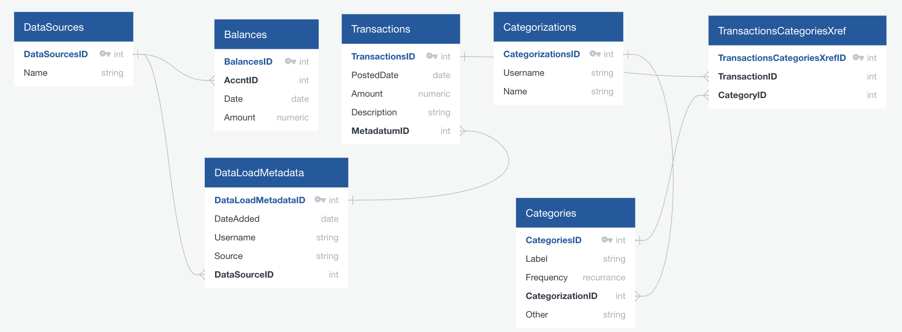

# FinTrackr: Personal finances and budgeting app

## Inputs

Users provide csvs of transactions (e.g. downloaded credit card statements from your bank).

FinTrackr will then classify each transaction (expense or income) by category (groceries, eating out, etc) and whether the expense is recurring, and on what frequency. Initially classification will be manual, but v2 will use an ML model (classical or local LLM, TBD).

Security: the database runs locally, nothing leaves your machine.

## Example usage

Currently the only interface is running scripts in a terminal. 

Dates are always assumed to be in format `%m/%d/%Y`, as in `10/3/2026`.

If your transcation csvs have headers, specify in the config file how the posted date, amount, and transaction description are represented in the header, under the `input_files` section. Multiple possibilities are allowed
(e.g., "Post Date" and "Date" can both be listed as options under `date_header`.) See below for details.

### Add accounts

Balances and transactions are logged for particular accounts (e.g., "primary credit card", "primary savings").

To add an account, in the terminal, run:
```
python ./src/fintrackr/add_account.py <account_name> <username> <pw>
```

where:
- `<account_name>` is the name of the account to add (case-insensitive - you can't have two accounts of the same name but different case)

- `<username>` and `<pw>` to connect to the db (see below for how to set up).

### Log transactions in the db

To log a list of transactions (amounts on dates, with text description provided by bank) into the db from a csv:

in the terminal, run

``` 
python ./src/fintrackr/load_transactions.py <account_name> <filepath> <username> <pw>
```

where:
- `<account_name>` is the name of an account in the db which had these transactions. 

- `<filepath>` is the full path to a csv with columns representing date, transactions amounts, and description.
Since this csv is determined by the bank, we tolerate multiple formats (see below).

- `<username>` and `<pw>` to connect to the db (see below for how to set up).

If your bank's csv has a header, specify the headers for columns represented posted date, amount, and description
in the config. If you have data from multiple banks with different formats, you can provide a list of options for each
column.

If your bank's csv has no header, Fintrackr will try to infer the correct columns based on types. In this case, there
shouldn't be multiple columns of dates with no header explaining them, or multiple text columns. The exception is '*' - 
some banks have columns whose values are '*', which we ignore.

Examples of supported transaction csv formats:

With a header: config here should include `posted_date: ['DATE']`, `amount: ['AMOUNT']`, `description: ['DESCRIPTION']`:
```
DATE,DESCRIPTION,AMOUNT,CHECK#,STATUS
07/19/2026,Chevron,-50.00,,Posted
```

Another header example: config would include `posted_date: ['Post Date']`, `amount: ['Amount']`, `description: ['Description']`:
```
Transaction Date,Post Date,Description,Category,Type,Amount,Memo
03/10/2026,03/12/2026,Local Coffee Bar,Food & Drink,Sale,-3.50,
```

No header, adds nothing to config:
```
09/10/2025,-26.57,*,,Safeway
08/21/2025,-100.00,*,128,CHECK # 128
```

Duplicates: the same transaction (`posted_date`, `amount`, `description`) aren't allowed to be loaded in the db, for the same
account OR different accounts; they will be skipped with a logged note. This means you can download overlapping data from your bank to ensure
you get all of it, without worrying about whether you've double-counted anything. Transactions are signed, meaning if you have a debited transaction
in one account that matches a credited transaction on another account (e.g. a credit card paid out of a checking account), these will not be considered
duplicate transaction (the sign is different on the amount).

### Log balances in the db

To log a list of account balances (amounts on dates) into the db from a csv:

in the terminal, run

``` 
python ./src/fintrackr/load_balances.py <account_name> <filepath> <username> <pw>
```

where:
- `<account_name>` is the name of an account in the db which had these balances. 

- `<filepath>` is the full path to a csv with columns representing date and amount. 

- `<username>` and `<pw>` to connect to the db (see below for how to set up).

Since these are user-generated (not from a bank), we insist they have a header with columns `balance_date` 
and `amount` (case insensitive). We also don't allow duplicates - if there are any duplicate entries with existing ones
in the database (or duplicates in the file itself), the whole load is blocked.

### Plot account balances

In the terminal, run

``` 
python ./src/fintrackr/plot_accnt_balances.py <account_name> <start_date> <end_date> <username> <pw>
```

where:
- `<account_name>` is the name of an account in the db for which transactions (and, optionally, balances)

- Account balances will be plotted between `<start_date>` and `<end_date>`. Balances logged in the db will be plotted,
as well as balances calculated as a result of all logged transactions on that account, between the specified dates.

- `<username>` and `<pw>` to connect to the db (see below for how to set up).


## Getting started

Install PostgreSQL (TODO add more install instructions).

Configure db name, input file headers, etc in `src/fintrackr/config.yml`.

Run (TODO add testing coverage for CLI version of init_db and other scripts)

```
python ./src/fintrackr/init_db.py <database admin password>
```

from the command line. A bunch of `CREATE` statements should print. This creates the Fintrackr database with owner name `fintrackr_admin` and the login password for `fintrackr_admin` that you specify. `fintrackr_admin` can create the database and create users. Admin name and db name are specified in the `config.yml` file.

Add new users with:

```
python ./src/fintrackr/add_user.py <new user name> <new user password> <db admin password>
```

Users are associated with data they add to the database. They can modify all tables but can't create users/roles; therefore the db owner's password must be passed so the admin can create the new user.

## Dev



*Schema diagram made at [QuickDataBaseDiagrams.com](https://app.quickdatabasediagrams.com), using a manual run of SQL_to_EDL.py from DBCommons (so inconsistency with actual db schema is possible!)*

This package uses `uv` for package and virtual environment management, based on the very helpful tutorials at [Sebastia Agramunt Puig's blog](https://agramunt.me/posts/python-virtual-environments-with-uv/).

Create the environment with `uv venv .venv` and then run `uv sync`, which installs the exact versions in `uv.lock`, including the `dev` dependency group (tools only needed for development, like `pytest`).

`uv sync` doesn't upgrade packages on its own. To upgrade, run `uv lock --upgrade-package <package>` (or `uv lock --upgrade` for everything), then `uv sync`, run the tests, and commit the updated `uv.lock`.

Activate with `source .venv/bin/activate`.

Add dependencies with `uv add <package1> <package2>` (or `uv add --dev <package>` for development-only tools). If you get an error that looks like:

```
No solution found when resolving dependencies:
  ╰─▶ Because there are no versions of unittest and your project depends on unittest, we can conclude that your project's requirements are
      unsatisfiable.
```
you already have the package (e.g. it's a package that comes with all python installs). I love `uv` but its error messages can be quite unhelpful.

Tests use `unittest` and are run with `pytest`. (For quick debugging: Add `-s` or `--capture=no` to print print statements to console.)

Quick manual testing/debugging setup using the tools in `testing_utils.py`: TODO update

```
import fintrackr.testing_utils as utils
params = utils.config_params()
FinDB = utils.set_up_test_DB(params=params)
```

When done, run:

```
tear_down_test_DB(db_conn = FinDB, params = params)
```

To regenerate the schema diagram, run `python src/fintrackr/SQL_to_EDL.py src/fintrackr/schema.sql`. A file `schema_EDL.txt` will appear in `src/fintrackr`.

## TODO 
- Enforce passwords
- Improve password handling - see TODO in DBCommons, also: Passwords passed as command-line arguments end up in your shell history. Read them from an environment variable or prompt with getpass.
- Possibly need to change permissions so that two users can see the same accounts/tables
- Automatically infer transactions to ignore (e.g. credit card payments from checking account, if have both lists of transactions and can compare)?
- Infer, or at least check, recurring charges and their frequencies
- Have a "MANUAL" category that requires manual intervention - e.g. Amazon transactions can't be categorized just from credit card data.